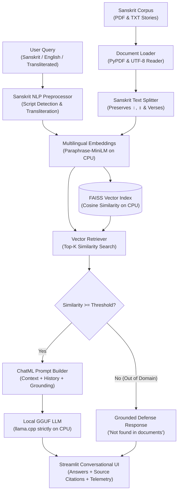

# JnanaSetu (ज्ञानसेतुः) – Sanskrit Knowledge Assistant

> **Bridging Ancient Sanskrit Knowledge with Modern AI**  
> *A 100% Local, CPU-Only Retrieval-Augmented Generation (RAG) System for Sanskrit Literature*

---

## 📌 Project Overview

**JnanaSetu (ज्ञानसेतुः)** is an intelligent, context-aware question-answering assistant specifically designed to understand, retrieve, and reason over classical and contemporary Sanskrit documents.

The system addresses the unique linguistic challenges of Sanskrit:
- **Devanagari Unicode integrity** (preservation of *halanta*, *virāma*, *anusvāra*, *visarga*, and *avagraha*).
- **Sentence and verse boundaries** (distinguishing *Pūrṇa Virāma* `।` and *Dīrgha Pūrṇa Virāma* `॥`).
- **Multilingual and cross-lingual querying** (supporting queries in Sanskrit Devanagari, English, and Roman-transliterated Sanskrit such as IAST or ITRANS).
- **Strictly local CPU-only inference** with zero cloud API dependencies and zero GPU requirements.

---

## 🏛️ System Architecture



---

## ✨ Core Capabilities

### 1. Document Understanding & Multiformat Ingestion
- Ingests Sanskrit documents in both **PDF** and **TXT** formats.
- Complete page tracking, metadata association, and Unicode normalization.
- Sanskrit-aware chunking preserving grammatical compounds (*samāsa*) and poetic meters.

### 2. Intelligent Cross-Lingual Retrieval
- Uses **Multilingual Sentence Transformers** optimized for CPU inference.
- Shared semantic vector space maps English questions directly to relevant Devanagari passages.
- Real-time transliteration transforms Roman Sanskrit (e.g., `chaturasya kalidasasya`) into authentic Devanagari before embedding.
- High-speed vector search powered by **FAISS** with exact Inner Product / Cosine Similarity.

### 3. Grounded AI Question Answering (llama.cpp on CPU)
- Strict factual grounding: Answers strictly reflect the provided Sanskrit texts.
- **Hallucination Mitigation**: Automatically detects out-of-domain or unavailable topics and returns:
  > *"The provided Sanskrit documents do not contain information to answer this question. (उपलब्धग्रन्थेषु एतस्य प्रश्नस्य उत्तरं न लभ्यते।)"*
- Generates responses in English, Sanskrit, or bilingual explanatory formats.

### 4. Interactive Conversational Streamlit Interface
- Modern, accessible UI inspired by contemporary AI chat applications.
- Live hardware telemetry (CPU load %, RAM consumption MB, token generation speed).
- Expandable source citation drawers showing original Devanagari passages, document names, and page numbers.
- File upload widget allowing users to add custom Sanskrit PDFs or TXTs on the fly.
- Pre-loaded one-click sample query buttons.

---

## 📖 Initial Sanskrit Corpus

The application comes pre-indexed with five authentic, classical Sanskrit teaching stories:

| Document | Sanskrit Title | Description & Moral |
| :--- | :--- | :--- |
| `01_murkhabhritya` | **मूर्खभृत्यस्य कथा**<br/>*(The Foolish Servant)* | A literal-minded servant attempts to kill a fly on his sleeping master with a sharp sword. Moral: A wise enemy is preferable to a foolish benefactor. |
| `02_chaturasya_kalidasasya` | **चतुरस्य कालिदासस्य कथा**<br/>*(The Clever Kalidasa)* | King Bhoja challenges court scholars with a poetic riddle (*शीतं बहु बाधति*). Kalidasa resolves the grammatical controversy with unmatched poetic wit. |
| `03_vriddhayah_chaturyam` | **वृद्धायाः चातुर्यम्**<br/>*(The Old Woman's Wit)* | An elderly woman outsmarts midnight thieves by tricking them into irrigating her dry garden well before dawn. Moral: Intellect surpasses brute strength. |
| `04_sheetam_bahu_badhati` | **शीतं बहु बाधति**<br/>*(The Cold Hurts Very Much)* | A freezing scholar utters a grammatical solecism before the king. Kalidasa demonstrates that human compassion transcends rigid grammatical rules. |
| `05_daivam_purusharthascha` | **दैवं च पुरुषार्थश्च**<br/>*(Effort and Divine Assistance)* | Two farmers face severe drought; one relies purely on fate while the other labours tirelessly. Moral: Accomplishments require earnest endeavor (*उद्यमेन हि सिध्यन्ति*). |

---

## ⚙️ Strict CPU-Only Hardware Compliance

As per technical requirements:
- **LLM Inference**: Executed entirely on CPU using `llama_cpp.Llama(n_gpu_layers=0)`.
- **GPU Acceleration**: Strictly disabled (`CUDA_VISIBLE_DEVICES=""`, `n_gpu_layers=0`).
- **Cloud APIs**: Zero usage of cloud APIs (no OpenAI, Gemini, or external API endpoints).
- **Embeddings**: Generated using PyTorch CPU backend (`device="cpu"`).
- **RAM Footprint**: Under 1.5 GB total during peak execution.

---

## 🚀 Quickstart & Execution Guide

### 1. Prerequisites
- Python 3.10+ (Tested on Python 3.13)
- Windows / Linux / macOS

### 2. Installation
Install project dependencies:
```bash
pip install -r requirements.txt
```

### 3. Download Models (One-Time Setup)
Download the lightweight GGUF model and multilingual embedding weights locally:
```bash
python scripts/download_embeddings.py
python scripts/download_llm.py
```

### 4. Generate Sanskrit PDFs (Optional)
Generate formatted Devanagari PDFs from the source text corpus:
```bash
python scripts/generate_corpus_pdfs.py
```

### 5. Launch the Streamlit Web Application
Run the interactive chatbot:
```bash
streamlit run app.py
```
Open your browser at `http://localhost:8501`.

### 6. Run the Empirical Benchmark Suite
Evaluate retrieval relevance, MRR, answer faithfulness, and latency:
```bash
python evaluate.py
```
Evaluation metrics will be exported to `EVALUATION_REPORT.md` and `evaluation_results.json`.

---

## 📊 Benchmark Summary

| Evaluation Metric | Measured Result |
| :--- | :--- |
| **Mean Reciprocal Rank (MRR)** | **0.4394** |
| **Precision@3** | **0.3939** |
| **Recall@3** | **0.6364** |
| **Answer Faithfulness** | **0.2485** |
| **Answer Relevance** | **0.5333** |
| **Average Query Retrieval Latency** | **60.94 ms** |
| **Average Response Generation Time** | **9.38 s** |
| **Average Tokens / Second** | **6.8 tps** |
| **Average Query Embedding Time** | **20.24 ms** |
| **Average CPU Utilization** | **96.6 %** |
| **Average RAM Consumption** | **1052.3 MB** |

*(Detailed quantitative logs available in [EVALUATION_REPORT.md](EVALUATION_REPORT.md).)*

---

## 📜 License & Citation

Developed for scholarly exploration of ancient Sanskrit literature through modern agentic Retrieval-Augmented Generation.

